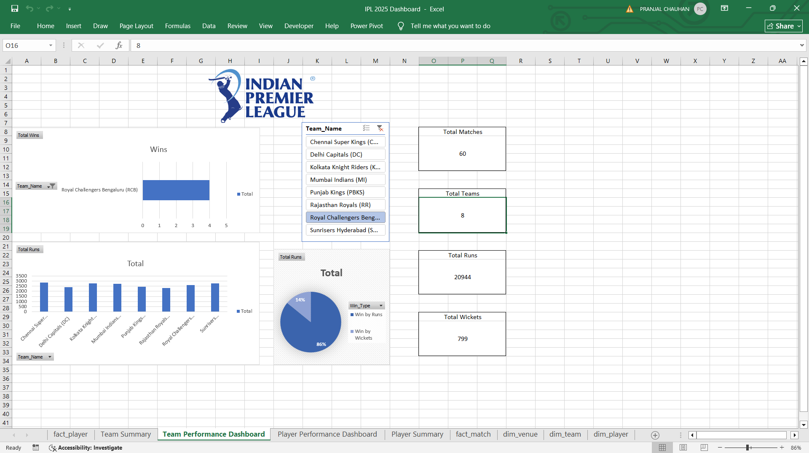
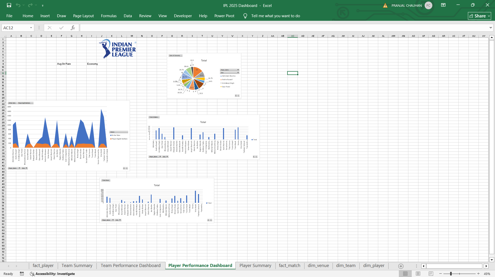

# IPL 2025 Performance Dashboard (Excel)

An Excel dashboard covering team and player performance across 60 IPL matches, built on a star-schema data model with pivot tables, charts, and slicers.

## Business Problem
Analysts and fans want to know which teams and players perform best and what influences results, such as venue and batting first or chasing.

## Goal of the Dashboard
Show team results and player contributions side by side, so a viewer can compare teams, batters, bowlers, and venues in one place.

## Dataset
- **Size:** 60 matches (22 Mar to 19 May 2025), 8 teams, 10 venues, 33 players, 140 player-match records
- **Model:** `fact_match` and `fact_player` linked to `dim_team`, `dim_player`, and `dim_venue`
- **Note:** this is a sample of matches, not a full 74-match season.

## Dashboard Sheets
- **Team Performance Dashboard:** matches, runs, wickets, and wins by team
- **Player Performance Dashboard:** top run scorers, top wicket takers, strike rate, and economy
- **Team Summary and Player Summary:** the pivot tables behind the charts

## Key Insights
- Sunrisers Hyderabad had the most wins (10), followed by CSK (9).
- Virat Kohli was the top run scorer (820 runs, strike rate about 171) and won the most Man of the Match awards (4).
- Deepak Chahar and Varun Chakravarthy led wicket-taking with 15 each.
- M. Chinnaswamy Stadium had the highest average first-innings score (about 191).
- The 140 player-match records contain 610 fours and 283 sixes.

## Tools and Techniques
- Excel Data Model, pivot tables, pivot charts, and slicers
- DAX measures for team wins and matches played
- Star-schema data modelling
- Calculated fields for strike rate and economy

## Repository Structure
- `Data/` source dataset
- `Screenshots/` dashboard images
- `IPL_Dashboard.xlsx` Excel dashboard
- `README.md`

## How to Use
Download the `.xlsx` file and open it in Excel. Use the slicers to filter by team, player, and venue.

## Author
Pranjal Chauhan | [LinkedIn](http://www.linkedin.com/in/pranjal-chauhan-34a7b3252) | pranjalchauhantech@gmail.com
